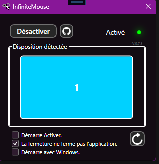
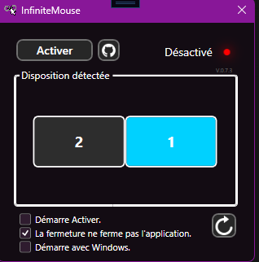
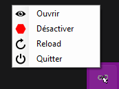

# InfiniteMouse 🖱️

**InfiniteMouse** rend votre curseur infini sur plusieurs écrans : quand la souris atteint le bord d'un écran, elle réapparaît automatiquement du côté opposé. Fini les coins où le curseur reste coincé entre deux moniteurs !

## Fonctionnalités

- **Curseur infini** : téléportation automatique d'un bord à l'autre du bureau virtuel
- **Détection multi-écrans** : aperçu visuel de la disposition de vos moniteurs (l'écran principal est surligné en bleu)
- **Icône système** : l'application vit dans la barre des tâches avec un menu contextuel (Ouvrir, Activer/Désactiver, Recharger, Quitter)
- **Démarre avec Windows** : crée automatiquement un raccourci dans le dossier Démarrage
- **Démarre activé** : la téléportation est active dès le lancement de l'app
- **Rechargement des écrans** : re-détecte vos moniteurs sans redémarrer (pratique si vous branchez ou débranchez un écran)
- **Mise à jour semi-automatique** : vérifie les nouvelles versions sur GitHub au démarrage
- **Paramètres sauvegardés** : vos préférences sont conservées entre les sessions

## Captures d'écran

**Fenêtre principale** — la LED passe au vert quand la téléportation est active. Cette LED passe au rouge lorsque la téléportation est désativé.

**Deux écrans détectés** — la disposition de vos moniteurs s'affiche automatiquement.

**Menu de la barre des tâches** — contrôlez l'application sans ouvrir la fenêtre.

## Installation

1. Téléchargez la dernière version depuis la page [Releases](https://github.com/samikaz35/InfiniteMouse/releases)
2. Télécharger le .msi pour utiliser l'installateur.
3. Prérequis : Windows 10/11 (et le runtime .NET 10 si la version n'est pas autonome)

## Utilisation

1. Cliquez sur **Activer** (ou passez par l'icône dans la barre des tâches)
2. Déplacez votre souris jusqu'au bord d'un écran — elle réapparaît de l'autre côté !
3. La LED passe au **vert** quand c'est activé, au **rouge** quand c'est désactivé

### Options

| Option | Description |
|--------|-------------|
| Démarre Activé | La téléportation est active dès le lancement |
| Démarre avec Windows | Crée un raccourci dans le dossier Démarrage de Windows, comme cela, l'application démarra avec Windows |
| La fermeture ne ferme pas l'application | Le bouton X minimise vers la barre des tâches au lieu de quitter |

## Comment ça marche

Un minuteur à 120 images par seconde surveille la position du curseur. Quand celui-ci s'approche à 1 pixel du bord d'un écran, il est téléporté au bord opposé du bureau virtuel total (avec une marge de 10 pixels pour éviter les boucles infinies).

## Technologies

- C# / .NET 10
- WPF (interface graphique)
- Windows Forms (icône système, détection des écrans)

## Auteur

**Samikaz35** — [GitHub](https://github.com/samikaz35)

---

*Un bug à signaler ou une idée à proposer ? Passez par les [Issues](https://github.com/samikaz35/InfiniteMouse/issues).*
